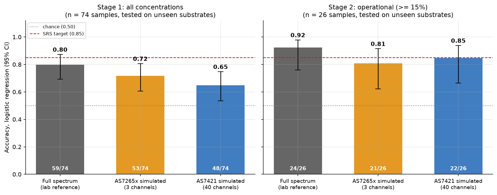
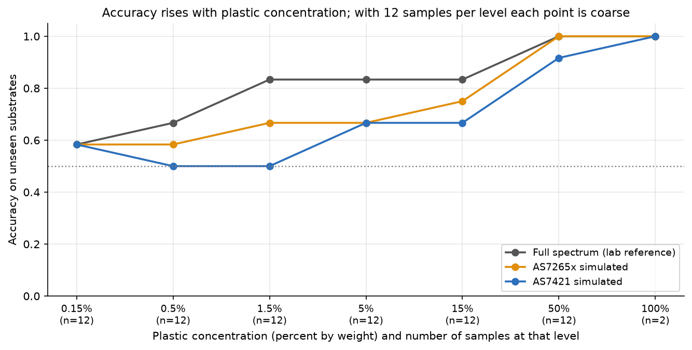

# Low-Cost Multispectral Pipeline for Distinguishing PLA from PET in Resource-Constrained Recycling

Final-year project, BSc Computer Science, Uganda Christian University (UCU).

**Status: preliminary.** This repository contains the first stage of the project: a reproducible simulation study on a public laboratory spectral library.
No physical sensor has been used yet. All numbers below come from `results/all_results.csv`, produced by the notebook in this repository.

## Research question
Can a low-cost spectral sensor (AS7265x or AS7421 class) separate PLA bioplastic from PET well enough to be useful in a resource-constrained recycling setting,
and which of the two chips is the better candidate?

## Data
Holt, Z. (2024). *NIR/SWIR Spectral Library of Plastic-Substrate Mixtures* (version 2) [Data set]. Zenodo. https://doi.org/10.5281/zenodo.14419753
Licence: CC BY 4.0. The record lists a related journal article: https://doi.org/10.1016/j.envpol.2025.126426. See `data/DATA_SOURCE.md`.

Files used: `__Mean_Spectra_Reflectance.csv` and `__Mean_Spectra_Absorption_der1.csv` (850 to 2400 nm, 1 nm step, 228 samples each).

What it contains for this project: 37 PET and 37 PLA mean spectra. They are made of one pure sample per plastic plus mixtures at six concentrations (0.15% to 50%)
in six backgrounds (three soils, crushed cement, oak leaf powder, deionised water). Spectra were pre-processed by the authors (continuum removal, SNV, smoothing).

## Method
1. Decode sample names into substrate, plastic and concentration.
2. Simulate each chip by averaging the laboratory spectrum into the chip's channels (Gaussian bands). Only channels that lie fully inside the library range (850 nm and above) are simulated:
   3 of the 18 AS7265x channels and 40 of the AS7421's.
3. Evaluate with **leave-one-substrate-out cross-validation**, so every prediction is made on a background the model has not seen.
4. Report accuracy with a 95% Wilson confidence interval, macro-F1, and a label-permutation test against chance.
   Primary model: logistic regression on SNV-normalised channels. Secondary: random forest. All configurations that were run are reported.
5. Three stages: all concentrations, an operational scope (at least 15% plastic, 26 samples), and derivative features.

## Results (logistic regression, tested on unseen substrates)

| Scope | Features | Accuracy | 95% CI |
|---|---|---|---|
| All concentrations (n = 74) | Full lab spectrum (reference) | 0.80 (59/74) | 0.69 to 0.87 |
| All concentrations (n = 74) | AS7265x simulated (3 channels) | 0.72 (53/74) | 0.60 to 0.81 |
| All concentrations (n = 74) | AS7421 simulated (40 channels) | 0.65 (48/74) | 0.54 to 0.75 |
| At least 15% plastic (n = 26) | Full lab spectrum (reference) | 0.92 (24/26) | 0.76 to 0.98 |
| At least 15% plastic (n = 26) | AS7265x simulated (3 channels) | 0.81 (21/26) | 0.62 to 0.91 |
| At least 15% plastic (n = 26) | AS7421 simulated (40 channels) | 0.85 (22/26) | 0.66 to 0.94 |



Main observations:
- Simulated reflectance channels separate PET from PLA above chance on unseen backgrounds, and accuracy rises with plastic concentration.
- The two chips are **not distinguishable** on these data (paired tests, p between 0.42 and 1.0). The direction of the difference even flips between scopes.
- Derivative features did not give a reliable improvement; the largest apparent gains are inside the confidence intervals.
- Accuracy depends strongly on the background (cement and water are hardest).



## Limitations
- The library holds **one pure PET and one pure PLA sample**. Every other row is the same plastic diluted into a background. Nothing here tests different products, colours, ageing or thickness.
- Pre-processed laboratory spectra are easier than raw sensor counts. Hardware accuracy will be lower.
- Simulated chips use ideal Gaussian channels, no noise, drift or LED illumination.
- The library starts at 850 nm, so most of the AS7265x's visible channels could not be simulated.
- 40 configurations were evaluated on small samples. The best single score is optimistic by selection.
- Supplier listings suggest the AS7421 is discontinued.

## Evaluation history
An earlier version of this project used a random 70/30 split and a 26-sample test of 8 samples. Samples from the same substrate appeared in both train and test sets, so those figures were not comparable to held-out-substrate results and have been superseded by this evaluation.

## Roadmap
- [x] Dataset inventory and selection
- [x] Chip simulation and leave-one-substrate-out evaluation (this repository)
- [ ] Systematic literature review: gap evidence for low-cost sensing in Africa
- [ ] Check raw ASD spectra for readings below 850 nm
- [ ] Add further PLA/PET spectral sources covering 400 to 1000 nm
- [ ] Sensor selection and procurement (confirm availability)
- [ ] Prototype: ESP32 plus sensor, white-reference calibration
- [ ] Hardware validation on real PLA and PET items (subject to supervisor approval)

## Repository layout
```
README.md
requirements.txt
01_zenodo_pla_pet_sensor_simulation.ipynb   main analysis notebook
data/                                       the two Zenodo CSV files, plus DATA_SOURCE.md
results/                                    figures and result tables written by the notebook
```

## Reproduce
```
pip install -r requirements.txt
```
Place the two CSV files in `data/`, open the notebook and choose Run All (about two minutes). Figures and tables are written to `results/`.

## Citation
If you use the data, cite the dataset above. Code in this repository is the author's own work for academic assessment.
